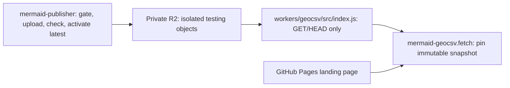

# GeoCSV hosting implementation and deployment

`bathymetrix-site` owns the read-only download service, landing page and hosting
infrastructure. Snapshot creation, scientific validation, gating, upload and
latest activation belong to `mermaid-publisher/scripts/geocsv/`.

The authoritative [publication/download contract](../../mermaid-publisher/docs/geocsv/CONTRACT.md),
[operator workflow](../../mermaid-publisher/docs/geocsv/WORKFLOW.md),
[scientific report schema](../../mermaid-publisher/docs/geocsv/VALIDATION.md), and
[historical archive findings](../../mermaid-publisher/docs/geocsv/ARCHIVE_FINDINGS.md)
are maintained by the publisher. Scientific APIs remain in `mermaid-geocsv`.
There are no publication commands or duplicate report/gating implementations here.

## Current status: testing only

All hosted data remain testing only. The local Worker implements isolated
`/geocsv/testing/` URLs and `geocsv/testing/` R2 keys, separate from future
production `/geocsv/` paths and keys. Each collection has its own latest pointer.
Testing pointers require `testing_only: true`; production pointers require false.
Testing successes carry `X-MERMAID-Testing: true` and pointer/redirect responses
are no-store. Immutable exact-byte responses and uncached errors retain their
existing controls. The landing page identifies testing status. The read-only
Worker was deployed on 2026-10-23; the testing bucket remains empty. No data upload or production
promotion is authorized by deployment.
The initial approved hosted batch is limited to P0006 and P0045. Instrument
scope is frozen at creation; local full-corpus validation is separate and may
use a temporary workspace without archival. Publishing transfers the exact
validated snapshot.

Publisher code enforces testing-only manifests and explicit testing destinations.
Its archive is `$MERMAID/publisher`, a separate local Git repository containing
testing GeoCSV products and evidence under
`geocsv/testing/{snapshots,staging,validation,publications}`, not original waveform
archives. The local namespace is derived from `testing_only: true`. Initial
workflow-testing artifacts may be retired through separately authorized cleanup
after verification. They are not permanent scientific releases; bytes remain
immutable until retirement and retired testing identities cannot be reused for
different bytes. Production retention remains indefinite. Website private
configuration and credentials remain outside both repositories.

Cloudflare authority, website proxy/TLS, post-proxy email and scoped Python-client
access were verified on 2026-10-22. DNSSEC remains disabled. Licensing/citation,
conditional writes, exact HTTPS downloads and DNSSEC restoration remain
pending. R2/Worker deployment and read-only SDK/HTTPS checks passed on
2026-10-23. Historical schema-2 archive acceptance does not accept a migrated
schema-3 candidate. Fresh full-corpus and separate P0006/P0045 schema-3 runs
subsequently passed 43,365 and 3,292 original waveform pairs, respectively, and
the current acceptance gates passed after the local testing-layout change. The
full check remains temporary; only the selected candidate is in the publication
archive. See the publisher’s [fresh findings](../../mermaid-publisher/docs/geocsv/SCHEMA3_FINDINGS.md).

## Read-only serving workflow



## Worker deployment preparation

`workers/geocsv/wrangler.example.jsonc` is a portable deployment template. Keep
actual configuration in an approved private location outside the checkout; supply the
approved private bucket binding. When the configuration is outside this
checkout, set its main entry point to an absolute path or a path relative to
that external configuration file, rather than assuming the current directory.
Keep public bucket URLs disabled. The existing
`bathymetrix.com/geocsv/*` route covers both collection namespaces, retaining
GitHub Pages as origin for the landing page and unrelated routes. There are no
upload/admin routes. No publishing script is retained by this website.

The Worker decodes timestamp URL components exactly once into literal storage
keys, streams uncompressed objects, and bypasses caches for latest/redirects.
It caches only successful immutable objects and honors no-cache verification.
Deployment must preserve exact bytes, identity encoding, cache isolation and
uncached misses. No generic zone cache rule should override these controls.

The approved deployment on 2026-10-23 activated the existing route and private
bucket binding. Live checks confirmed storage access, expected uncached pointer
and object misses, and unchanged landing-page bytes. No data objects or pointers
were written. Successful-object testing labels, exact payload bytes, immutable
caching and conditional writes remain pending. Deployment logs and verification
evidence are retained privately outside the checkouts.

## DNS onboarding and remaining activation steps

Cloudflare authoritative DNS onboarding and website proxy activation are
complete as of 2026-10-22. All imported records were compared with Squarespace
and confirmed to match. Full (strict) is configured and only apex/www website
records are proxied; email and other service records remain unchanged. DNSSEC is
disabled. Squarespace remains registrar and GitHub Pages remains the website origin.

Public checks confirmed Cloudflare authority through two independent recursive
resolvers. Before proxy activation, origin-path HTTPS checks passed. After
activation, apex/www HTTPS validated successfully through Cloudflare, HTTP and
`www` redirected to apex HTTPS without loops, and Home, About, Work and Contact
returned 200 with Cloudflare edge responses. The Active Universal certificate
covers apex/www. Fresh post-proxy email sending and receiving both passed.

Browser Integrity Check initially blocked ordinary Python urllib requests
under `/geocsv/` with 403. Cloudflare Security Events identified the blocking
feature. A configuration rule now disables only
[Browser Integrity Check](https://developers.cloudflare.com/waf/tools/browser-integrity-check/)
for GET/HEAD requests on the collection's apex/www hostnames under `/geocsv/`.
Other paths and security settings retain their existing policy. Keep actual
rule configuration and account-specific records outside the repository.

Post-deployment checks on 2026-10-22 passed with the normal Python user agent and
identity encoding: GET and HEAD returned 200 for `/geocsv/` and 404 for the
unpublished `/geocsv/latest.json`, on both apex and www. The unmodified
`geocsv.fetch` client reached that expected manifest 404 rather than a security
403. This verifies edge access, not a complete download. Complete unmodified
fetch-client and publisher HTTP verification against a separate illustrative
release under the same base after R2/Worker test hosting is prepared. This does
not authorize production data publication.

The remaining sequence is: publish the prepared testing scope, citation and
retirement notice through the normal website workflow; obtain explicit testing
upload authorization; recheck the exact accepted candidate; verify complete
downloads and publication transport; and restore DNSSEC. Production data
activation separately requires current scientific acceptance and explicit
authorization.
Each infrastructure change requires explicit coordination.

Keep actual zone exports, inventories, account context and deployment
configuration outside this repository in an approved private location; use
placeholders in repository procedures. The procedure below retains the completed
onboarding, website proxy and scoped client-access steps for reference.
R2/Worker deployment in step 7 is complete; landing-page publication and
end-to-end download checks remain pending.

1. **Inventory and baseline.** Export the complete existing zone from Squarespace.
   Save apex/www website records, MX priorities, SPF, DKIM selectors, DMARC,
   verification TXT, CAA, SRV, wildcard and other service records with TTLs. Note
   actual registrar DS/DNSSEC state separately. Confirm GitHub Pages custom
   domain, HTTPS certificate, apex/www redirects, current pages, and email
   send/receive behavior. Preserve GitHub ownership verification records.
2. **Prepare Cloudflare without changing nameservers.** Add the existing domain
   as a full zone. Import and compare every record against the export, including
   email and service records automatic scanning may miss. Keep all records
   DNS-only initially, especially MX and mail-related A/CNAME records. Leave the
   registrar and GitHub Pages custom-domain configuration unchanged. Do not
   invent apex A records or substitute a guessed CNAME target.
3. **Handle DNSSEC.** If a DS record exists, use a coordinated DNSSEC migration or
   remove/disable the old DS at the registrar and wait until public validation
   confirms it is gone before switching providers. Do not switch to unrelated
   nameservers while an old DS chain remains. Retain the old zone and record
   values for recovery. See Cloudflare's full-setup guidance below.
4. **Review the proposed change.** Record Cloudflare's assigned nameservers,
   the complete compared record set, current/target proxy settings, DNSSEC steps,
   TTL/propagation expectations, and rollback steps. Obtain explicit authorization
   before changing live DNS or deploying the Worker.
5. **Approved migration only.** Change authoritative nameservers at Squarespace
   to the assigned Cloudflare pair. Keep GitHub Pages as origin and start DNS-only.
   Confirm authority and answers from multiple resolvers, website TLS/redirects,
   and email. Preserve the prior zone during propagation; allow for cached TTLs.
6. **Verify TLS and enable only the website proxy.** Confirm an Active
   [edge certificate](https://developers.cloudflare.com/ssl/edge-certificates/universal-ssl/enable-universal-ssl/)
   covering apex/www in Cloudflare. DNS-only HTTPS does not test that certificate.
   Configure [Full (strict)](https://developers.cloudflare.com/ssl/origin-configuration/ssl-modes/full-strict/)
   after confirming the GitHub Pages origin has a valid matching certificate.
   Then enable proxying only for the website hostname records needed for the
   Worker. Recheck apex/www TLS, redirects, main pages and email send/receive.
   Email/service records remain DNS-only. If origin TLS or loops fail, revert
   the website records to DNS-only while diagnosing.
7. **Approved hosting deployment.** Create the private bucket and least-privilege
   operator access, set the read binding, deploy the Worker route, and ship the
   landing page via the normal GitHub Pages workflow. Test routing, streaming,
   no-cache latest, 404 then object availability, and identity encoding before
   any production activation. Do not publish illustrative fixtures as
   production data or upload real data without the acceptance report.
8. **Restore DNSSEC.** After the migration is stable, enable Cloudflare DNSSEC,
   install its new DS at Squarespace, and verify the new chain. Do not reuse the
   old provider's DS. Recheck website and email after enabling validation.
9. **Recovery.** A Worker fault can be isolated by removing its route or making
   website records DNS-only, preserving GitHub Pages. Returning nameservers to
   the previous provider requires first removing any incompatible Cloudflare DS,
   waiting for that change, and restoring the preserved old zone/valid DNSSEC
   chain. Keep both zones consistent while resolver caches expire. Data rollback
   changes only the latest pointer after verification, never immutable releases.

Official references checked for this implementation:

- [Worker routes and proxied DNS](https://developers.cloudflare.com/workers/configuration/routing/routes/)
- [Full DNS setup and DNSSEC](https://developers.cloudflare.com/dns/zone-setups/full-setup/setup/)
- [R2 Worker streaming API](https://developers.cloudflare.com/r2/api/workers/workers-api-reference/)
- [Atomic conditional S3 writes](https://developers.cloudflare.com/r2/api/s3/extensions/)

## Verification and remaining hosting work

```bash
cd workers/geocsv
node --test test/worker.test.js
```

Worker tests cover streaming, encoding, cache behavior, isolated testing
pointers/objects/redirects and flag rejection. Scientific and publisher tests
run in `mermaid-publisher`; none are duplicated here.

- [x] Separate read-only hosting from the publisher workflow and contract.
- [x] Implement local testing namespace isolation and explicit response labeling.
- [x] Complete DNS authority, proxy/TLS, email and scoped Python-client checks.
- [x] Limit hosted testing to P0006/P0045 and prepare the MH network citation.
- [x] Obtain fresh schema-3 acceptance for the selected candidate.
- [ ] Publish and verify the testing scope, citation and retirement notice before
  data uploads. Full-corpus licensing remains deferred.
- [x] Deploy approved private R2/Worker configuration and verify read-only SDK
  access. Conditional write transport remains unverified.
- [x] Verify unchanged landing-page bytes, GET/HEAD misses, no-store errors,
  identity encoding on misses and www-to-apex routing. The bucket is empty and
  testing/production pointers are absent.
- [ ] Verify exact deployed bytes, caches, misses, testing flags and pointer isolation.
- [ ] Verify pinned/latest fetch, one/all instruments, memory/disk and scientific use.
- [ ] Restore and verify DNSSEC after hosting verification.

All deployment and remote publication require explicit authorization. Production
promotion and first formal release remain separately unauthorized.
