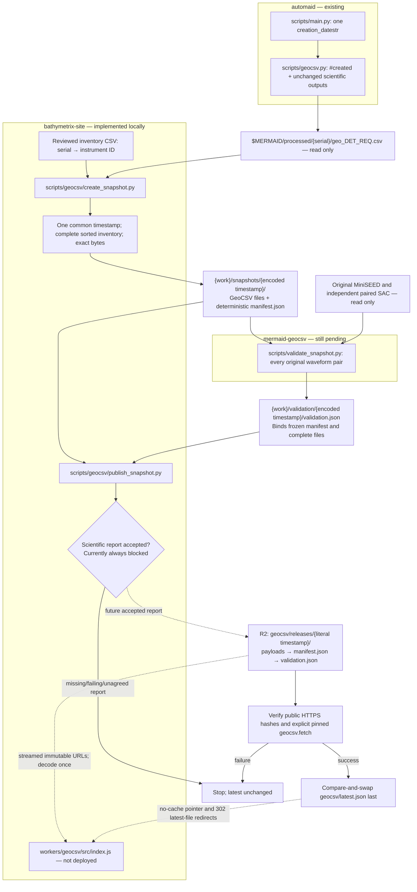

# GeoCSV hosting implementation and deployment

The website remains on GitHub Pages, domain registration remains at Squarespace,
and GeoCSV payloads will live in private Cloudflare R2 storage. The planned public
collection is `https://bathymetrix.com/geocsv/`, served by a read-only Worker route.
No DNS, bucket, Worker, or production release has been activated by this change.

The cross-repository design is `mermaid-geocsv/docs/HOSTING.md` (2026-10-22).
This document and `data/geocsv/testing/CONTRACT.md` record website implementation
status. Coordinate upstream diagram/checklist updates with the package chat;
this change does not edit that repository or automaid.

## Implemented versus pending

| Component | State |
| --- | --- |
| `scripts/geocsv/create_snapshot.py` | Implemented; offline tests for verbatim staging, identity, inventory, and immutable retries |
| `scripts/geocsv/snapshot.py` | Private shared helpers; production manifest and exact-byte checks |
| `workers/geocsv/src/index.js` | Implemented and tested with R2/Cache API doubles; not deployed |
| `scripts/geocsv/publish_snapshot.py` | Local preflight and tested transfer sequence; publication always blocked pending acceptance protocol |
| `geocsv/index.html` | Landing page prepared for GitHub Pages; no live availability claim |
| `mermaid-geocsv/scripts/validate_snapshot.py` | Package-owned, still pending; report format and full archive run required |
| DNS migration and real HTTPS/client integration | Prepared below; not executed |
| Data license and citation | Owner decisions required before production publication; software licensing does not license the data |

Source references inspected on 2026-10-22:

- `automaid` at `e841a1a0e2607582f10631c4f5989286d42d346b`:
  `scripts/main.py` computes one `creation_datestr` per run;
  `scripts/geocsv.py` emits it as `#created` and writes `geo_DET_REQ.csv`.
- `mermaid-geocsv` at `20f5f317751b33ba425cf8ed74d29bc5fe05e3e7`:
  `_fetch.py` and public exports, version 0.24.0, retain literal release IDs,
  encode URL/local components with `quote(..., safe="")`, and verify exact bytes.

## Current workflow

Paths in repository subgraphs are relative to that repository. `{work}` is an
external workspace outside Git and the protected processed tree. Payloads,
reports, inventories, and fetch verification outputs stay there.



## Create a frozen candidate

Use Python 3.9 or newer; staging and offline tests use only the standard library.
The website has no `.venv`; if one is added, use it. Pause upstream processing
while freezing a candidate. The creator detects ordinary source changes during
copying, but cannot obtain an atomic snapshot of an archive being rewritten.

Prepare a reviewed CSV **outside Git** with these exact columns:

```csv
instrument_serial,instrument_id
452.020-P-06,P0006
```

This is an illustration, not a complete archive inventory. The creator does not
infer IDs from serial suffixes. It checks every Station record against the
explicit mapping and requires the inventory to cover every immediate serial
directory containing `geo_DET_REQ.csv`. Missing files, unlisted serials, repeated
serials/IDs, unsafe IDs, and inconsistent Station values raise. With
`--previous-manifest`, any previously published instrument missing now raises.
After the first publication, supply its retained manifest on every staging run;
the publisher also compares against the current remote latest inventory.

From the website repository, using a chosen external workspace:

```bash
python3 scripts/geocsv/create_snapshot.py \
  --source-root "$MERMAID/processed" \
  --workspace /path/to/publication-work \
  --inventory /path/to/publication-work/instruments.csv
```

On later runs, add `--previous-manifest /path/to/previous/manifest.json`.
The creator requires exactly one valid UTC `#created` in every file and exact
spelling agreement across all files. Fractional digits are preserved. It copies
verbatim, sorts by instrument ID, and writes deterministic JSON without a new
creation/publication timestamp. Source provenance is relative to the processed
root. Identical retries preserve the frozen manifest; conflicting bytes or
inventories at the same timestamp fail. Historical rows need not change.

Successful output is `{work}/snapshots/{encoded release_id}/`. Freeze that exact
candidate for the package-owned validator; never edit it after validation.

## Publisher status and acceptance handoff

Local preflight is available now and performs no network writes:

```bash
python3 scripts/geocsv/publish_snapshot.py \
  --candidate /path/to/publication-work/snapshots/2026-10-21T22%3A48%3A33.277Z \
  --plan
```

Without `--plan`, the command **always exits before creating an R2 client**.
There is no `--force`, test report acceptance, sampled-check fallback, or report
schema invented by this repository. `require_scientific_acceptance` must be
implemented only after the package owner supplies the concrete protocol.

Required handoff: report release ID, SHA-256 of the exact frozen manifest,
complete staged-file hash inventory, complete original MiniSEED/SAC accounting,
scientific comparison results and limits, versions, and individual failures.
The report must reject missing/unsupported/unexamined files and failed checks.
Public evidence uses source-relative paths. The report binds the manifest;
the manifest must not contain the report hash. Agreement must specify concrete
field names, report version, completeness accounting, and pass criteria.

The private transfer sequence is tested with synthetic in-memory storage and
transport-only report bytes. These are not scientific acceptance reports. It
rechecks the candidate, compares existing immutable objects and inventory,
conditionally creates payloads before the manifest and separate validation
report, checks public HTTPS bytes with `Accept-Encoding: identity`, then runs
explicitly pinned public `geocsv.fetch`. Only after success does it conditionally
replace latest. It rechecks the candidate/report before activation. Identical
remote objects are reused; conflicting bytes or inventory stop publication.

Before enabling this command, add a real accepted-report test and rejection
tests for changed manifests/files, missing coverage, and scientific failures;
run the complete local archive. The transport uses optional `boto3` plus the
installed `mermaid-geocsv` client. Configure R2 credentials through the SDK's
normal credential provider outside the repository; never put them in commands,
tracked files, or logs. SDK/version deployment validation remains pending.

All publishers must use the same external workspace. An exclusive local lock
serializes publication; inspect stale locks after crashes before manually
removing one. Atomic conditional R2 writes protect immutable objects and detect
competing latest updates. There is no automatic retry after an ambiguous write;
read and verify the committed state before retrying.

Rollback means selecting a retained, already validated immutable release and
running the same verification/activation process after the real report gate is
implemented. Never delete new or previous releases to roll back. The current
publisher remains blocked for rollback as well. The missing-instrument policy
also applies; review intentional collection changes explicitly rather than
bypassing the check.

## Worker deployment preparation

`workers/geocsv/wrangler.example.jsonc` is an **example**, with an intentionally
unresolved bucket name. No deployment configuration with account credentials is
provided. After approval, copy it to ignored `wrangler.jsonc`, supply the approved
private bucket name, and use a reviewed Wrangler version to validate/deploy it.
The Worker has only a read binding and no upload/admin routes. Leave public R2
bucket URLs disabled; production requests use the Worker.

R2 keys start `geocsv/`; release keys contain literal timestamp colons. URLs use
encoded colons. The Worker decodes the release component once, rejects malformed
or double-encoded paths, streams bodies without buffering payloads, and forwards
`/geocsv/` to the GitHub Pages landing page. Other site paths keep their origin.
The route is `bathymetrix.com/geocsv/*`, not a Worker Custom Domain replacing the
whole website. Visit the trailing-slash landing URL.

Latest pointer responses and 302 redirects are `no-store`. Successful immutable
responses are `public, max-age=31536000, immutable, no-transform`, with deliberate
Cache API storage. Missing/error responses are never cached. A request with
`Cache-Control: no-cache` forces an R2 read for publication verification. Do not
create a zone-wide cache rule overriding these controls; explicitly bypass edge
cache for `/geocsv/latest.json` and `/geocsv/latest/*`, disable negative caching
for `/geocsv/*`, and verify `Accept-Encoding: identity` returns exact bytes.

## DNS migration runbook — prepare before activation

The handoff reports Squarespace registration ($20/year), no paid Squarespace
website hosting subscription, GitHub Pages origin `bathymetrix.github.io`, and
nameservers `ns-cloud-c1.googledomains.com` through `ns-cloud-c4.googledomains.com`
as of 2026-10-22. Recheck immediately before changes. This is a plan, not a fresh
DNS/account audit. DNS export, DNSSEC state and email records have not been
provided; do not infer missing values from an automatic DNS scan.

1. **Inventory and baseline.** Export the complete existing zone from Squarespace.
   Save apex/www website records, MX priorities, SPF, DKIM selectors, DMARC,
   verification TXT, CAA, SRV, wildcard and other service records with TTLs. Note
   actual registrar DS/DNSSEC state separately. Confirm GitHub Pages custom
   domain, HTTPS certificate, apex/www redirects, current pages, and email
   send/receive behavior. Preserve GitHub ownership verification records.
2. **Prepare Cloudflare without changing nameservers.** Add the existing domain
   as a full zone. Import and compare every record against the export, including
   email and service records automatic scanning may miss. Keep all records
   DNS-only initially, especially MX and mail-related A/CNAME records. Leave the
   registrar and GitHub Pages custom-domain configuration unchanged. Do not
   invent apex A records or substitute a guessed CNAME target.
3. **Handle DNSSEC.** If a DS record exists, use a coordinated DNSSEC migration or
   remove/disable the old DS at the registrar and wait until public validation
   confirms it is gone before switching providers. Do not switch to unrelated
   nameservers while an old DS chain remains. Retain the old zone and record
   values for recovery. See Cloudflare's full-setup guidance below.
4. **Review the proposed change.** Record Cloudflare's assigned nameservers,
   the complete compared record set, current/target proxy settings, DNSSEC steps,
   TTL/propagation expectations, and rollback steps. Obtain explicit authorization
   before changing live DNS or deploying the Worker.
5. **Approved migration only.** Change authoritative nameservers at Squarespace
   to the assigned Cloudflare pair. Keep GitHub Pages as origin and start DNS-only.
   Confirm authority and answers from multiple resolvers, website TLS/redirects,
   and email. Preserve the prior zone during propagation; allow for cached TTLs.
6. **Enable only the website proxy.** Once the zone and certificates are ready,
   proxy the actual website hostname records needed for the Worker. Use Full
   (strict) TLS with the existing valid GitHub Pages origin certificate, not
   Flexible. Recheck apex/www redirects and the main pages through the proxy.
   Email/service records remain DNS-only. If origin TLS or loops fail, revert
   the website records to DNS-only while diagnosing.
7. **Approved hosting deployment.** Create the private bucket and least-privilege
   operator access, set the read binding, deploy the Worker route, and ship the
   landing page via the normal GitHub Pages workflow. Test routing, streaming,
   no-cache latest, 404 then object availability, and identity encoding before
   any production activation. Do not promote the illustrative `test-001` to
   production or upload real data without the acceptance report.
8. **Restore DNSSEC.** After the migration is stable, enable Cloudflare DNSSEC,
   install its new DS at Squarespace, and verify the new chain. Do not reuse the
   old provider's DS. Recheck website and email after enabling validation.
9. **Recovery.** A Worker fault can be isolated by removing its route or making
   website records DNS-only, preserving GitHub Pages. Returning nameservers to
   the previous provider requires first removing any incompatible Cloudflare DS,
   waiting for that change, and restoring the preserved old zone/valid DNSSEC
   chain. Keep both zones consistent while resolver caches expire. Data rollback
   changes only the latest pointer after verification, never immutable releases.

Official references checked for this implementation:

- [Worker routes and proxied DNS](https://developers.cloudflare.com/workers/configuration/routing/routes/)
- [Full DNS setup and DNSSEC](https://developers.cloudflare.com/dns/zone-setups/full-setup/setup/)
- [R2 Worker streaming API](https://developers.cloudflare.com/r2/api/workers/workers-api-reference/)
- [Atomic conditional S3 writes](https://developers.cloudflare.com/r2/api/s3/extensions/)

## Verification and remaining launch decisions

From the website root:

```bash
python3 -B -m unittest discover -s tests -v
cd workers/geocsv
node --test test/worker.test.js
```

Tests use synthetic small data and do not contact Cloudflare. They cover source
identity/inventory, timestamp grammar and fractional spelling, immutable retries,
interrupted uploads, checksum/remote-inventory conflicts, failed verification,
concurrent activation, literal R2 keys versus encoded URLs, stream/cache behavior,
and preservation of website origin routing. They do not prove deployed R2/Worker
behavior, scientific correctness, real archive coverage, or live DNS readiness.

Before launch, agree with the owner on data redistribution license, attribution,
recommended citation/DOI, and retention obligations. Confirm actual DNS/email
records and current DNSSEC. Obtain the package-owned report protocol and a real
full-archive pass, then finish the gate and real HTTPS tests for pinned/latest,
one/all instruments, disk/memory downloads, and `fetch → read → associate →
write_sac`. Update this plan, diagram, and upstream hosting checklist together.

## Handoff to the mermaid-geocsv chat

Website staging, the production contract, Worker, and offline publication
machinery now exist at the paths above. Please synchronize the canonical
`docs/HOSTING.md` diagram/checklist with these statuses, retaining scientific
validation and live deployment as pending. Website code does not change the
fetch API or scientific comparison rules.

The acceptance adapter remains deliberately closed. Supply the concrete
versioned report protocol and its complete-coverage/pass criteria so the website
can verify release ID, exact manifest SHA-256, every staged file fingerprint,
complete waveform accounting, and scientific failures without guessing fields.
Coordinate that addition before enabling production publication. The manifest
has no report hash; report evidence stays separate to avoid circular hashes.
