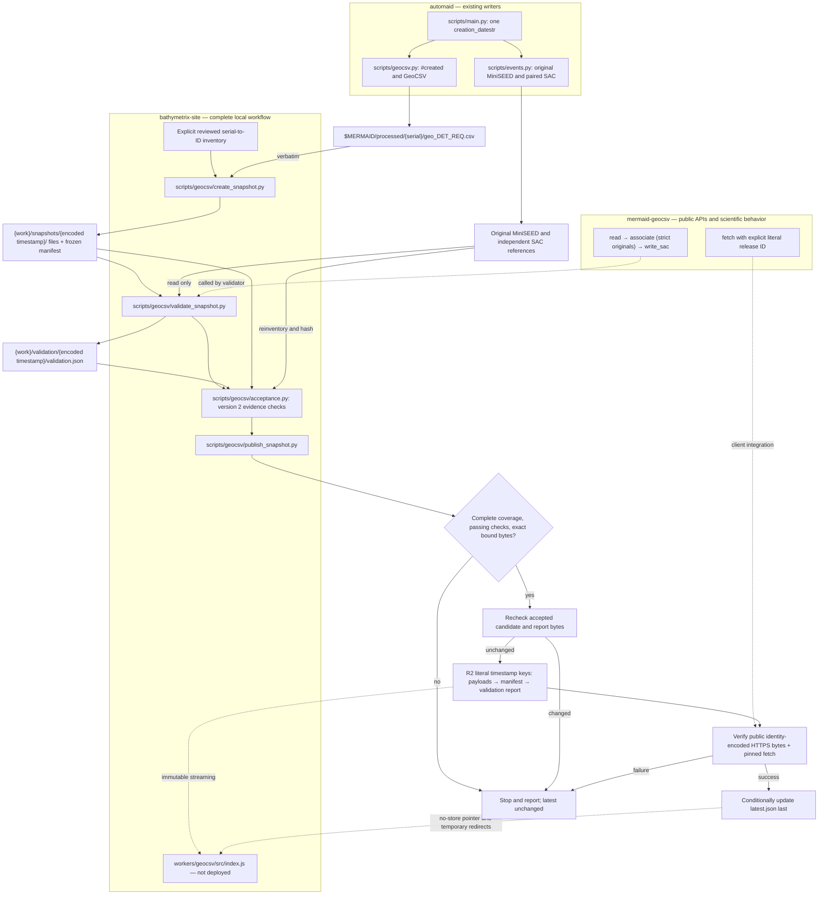

# GeoCSV hosting implementation and deployment

`bathymetrix-site` owns the complete create → validate → publish workflow,
including the versioned scientific acceptance report. The public collection is
planned at `https://bathymetrix.com/geocsv/`. GitHub Pages remains the website
origin and Squarespace remains registrar. The planned data service uses private
Cloudflare R2 storage and a read-only Worker route. That infrastructure is not
activated.

`mermaid-geocsv` supplies the public `read`, `associate`, `write_sac` and `fetch`
APIs and their scientific contracts. It does not supply a publication validator
or report protocol. Package defects are reported with reproducible evidence and
fixed in the package; the website does not duplicate matching or projection.

## Implementation status

| Component | State |
| --- | --- |
| `scripts/geocsv/create_snapshot.py` | Verbatim staging, explicit inventory, shared timestamp, deterministic manifest |
| `scripts/geocsv/validate_snapshot.py` | Full original MiniSEED/paired SAC inventory and public-API scientific comparisons |
| `scripts/geocsv/acceptance.py` | Version 2 report protocol, evidence checks and source/candidate fingerprint rechecks |
| `scripts/geocsv/publish_snapshot.py` | Report acceptance → recheck → conditional upload → HTTPS/client verification → latest last |
| `workers/geocsv/src/index.js` | Streaming, one URL decoding step, no-cache latest, immutable release caching; not deployed |
| `geocsv/index.html` | Prepared landing page; production downloads are not advertised as available |
| DNS, licensing/citation, deployment and live HTTPS | Pending |

The 2026-10-22 complete local archive run passed all 43,365 original waveform
pairs under report version 2, and the publisher's acceptance gate accepted the
report after input/code rechecks. See [archive findings](GEOCSV_ARCHIVE_FINDINGS.md).
Future candidates require their own complete run and matching evidence. Reports
and payloads remain outside Git. No publication, DNS activation, commit, tag or
software release is implied by a local validation pass.

## Workflow

Paths are relative to their named repository. `{work}` is outside Git and the
protected processed tree. Every protected input is read-only.



## Create and validate a frozen candidate

Staging remains standard-library-only. Validation and publication acceptance
require Python 3.11+ and `mermaid-geocsv` with its ObsPy extra. Use the repository's
`.venv` when present. No environment is created or modified automatically.

Use a reviewed CSV outside Git with exact columns `instrument_serial,instrument_id`.
IDs are explicit; serial suffixes are not treated as authoritative. The creator
checks Station records, complete source inventory, duplicates and shared literal
`#created`. Recordless sources are never staged or published. Their explicit IDs,
source paths, timestamps, sizes, hashes and exclusion reasons are retained in the
local-only `{work}/staging/{release_component}/inventory.json` sidecar. The sidecar
accounts for every source instrument and is not uploaded. Validation/acceptance
reject an excluded directory containing original waveform inputs, so exclusions
cannot conceal unexamined originals. Supply `--previous-manifest` after the first publication to reject
unexpectedly missing instruments. Pause upstream processing before staging.

```bash
python3 scripts/geocsv/create_snapshot.py \
  --source-root "$MERMAID/processed" \
  --workspace /path/to/publication-work \
  --inventory /path/to/publication-work/instruments.csv

python3 scripts/geocsv/validate_snapshot.py \
  --candidate /path/to/publication-work/snapshots/2026-10-21T22%3A48%3A33.277Z \
  --source-root "$MERMAID/processed" \
  --report /path/to/publication-work/validation/2026-10-21T22%3A48%3A33.277Z/validation.json
```

Reports use exclusive creation. A rerun needs a new report path; never change the
frozen manifest to describe report or publication time. Temporary SAC exports
are outside Git and deleted after comparison. Validation processes one instrument
at a time and bounded batches (default 128 original traces), without merging,
calibrating, repairing samples or using the containing-anchor fallback.

[The report protocol and scientific checks](GEOCSV_VALIDATION.md) define scope,
units, precision and acceptance. `.mhpsd` spectra are outside scope and are not
counted. Missing pairs, unsupported waveform formats/products, unreadable inputs,
and unexamined comparisons remain explicit failures. The fixture checker is not
an alternative to this full-archive run.

## Acceptance and publication

The report is bound to literal release ID, exact manifest SHA-256, every staged
file, all original waveform input fingerprints/pairs, scientific results,
measured maxima, limits, code hashes and dependency versions. Acceptance rechecks
candidate bytes and the complete source inventory, reconstructs pair accounting,
and requires every check to pass. An arbitrary success flag cannot authorize
publication. Code/dependency changes require a new validation run.

```bash
python3 scripts/geocsv/publish_snapshot.py \
  --candidate /path/to/publication-work/snapshots/2026-10-21T22%3A48%3A33.277Z \
  --report /path/to/publication-work/validation/2026-10-21T22%3A48%3A33.277Z/validation.json \
  --source-root "$MERMAID/processed" \
  --plan
```

`--plan` checks local candidate structure and displays a read-only plan. It does
not authorize or perform uploads. An actual publication, only when explicitly
instructed, also needs the approved R2 S3 endpoint and bucket. The optional R2
transport uses `boto3`; credentials come from its normal provider outside Git.
Never put credentials in command arguments, tracked files or logs.

Publication serializes through one external workspace lock and uses conditional
R2 writes. It uploads payloads before the manifest and separate `validation.json`,
verifies public HTTPS identity bytes/checksums and explicitly pinned public
`geocsv.fetch`, then compare-and-swaps latest last. Candidate/report changes after
acceptance or during transfer raise. Identical immutable retries reuse objects;
conflicting bytes or inventories raise. The report binds the manifest; the
manifest never depends on a report hash.

Use one publication workspace for all operators. A crash leaves a visible lock;
inspect it and the remote committed state before removing it or retrying an
ambiguous write. Rollback selects a retained, accepted immutable release through
the same checks; it never deletes or rewrites releases. The current remote
inventory still protects against unexpectedly missing instruments.

## Worker deployment preparation

`workers/geocsv/wrangler.example.jsonc` is an undeployed template with an unresolved
bucket name. Keep actual deployment configuration in an approved private location outside
the checkout, including any local Wrangler configuration. Use the read-only binding and keep public bucket URLs disabled.
The route is `bathymetrix.com/geocsv/*`, retaining the GitHub Pages origin and
landing page. There are no public upload/admin routes.

Object keys use literal timestamp colons; URLs encode them. The Worker decodes
once, streams uncompressed bytes, sets appropriate content metadata, bypasses
caches for latest/redirects, caches successful immutable objects, and does not
cache errors or misses. Deployment must preserve those controls. Publication
verification requests force R2 reads with `Cache-Control: no-cache` and request
`Accept-Encoding: identity`. Do not override this with a broad zone cache rule.

## DNS migration runbook — prepare before activation

Domain registration remains at Squarespace and the website origin is GitHub
Pages. Confirm current authoritative nameservers, website/email records and
DNSSEC privately before changes. Keep actual zone exports, inventories,
account context and deployment configuration outside this repository in an
approved private location; use placeholders in repository procedures.

1. **Inventory and baseline.** Export the complete existing zone from Squarespace.
   Save apex/www website records, MX priorities, SPF, DKIM selectors, DMARC,
   verification TXT, CAA, SRV, wildcard and other service records with TTLs. Note
   actual registrar DS/DNSSEC state separately. Confirm GitHub Pages custom
   domain, HTTPS certificate, apex/www redirects, current pages, and email
   send/receive behavior. Preserve GitHub ownership verification records.
2. **Prepare Cloudflare without changing nameservers.** Add the existing domain
   as a full zone. Import and compare every record against the export, including
   email and service records automatic scanning may miss. Keep all records
   DNS-only initially, especially MX and mail-related A/CNAME records. Leave the
   registrar and GitHub Pages custom-domain configuration unchanged. Do not
   invent apex A records or substitute a guessed CNAME target.
3. **Handle DNSSEC.** If a DS record exists, use a coordinated DNSSEC migration or
   remove/disable the old DS at the registrar and wait until public validation
   confirms it is gone before switching providers. Do not switch to unrelated
   nameservers while an old DS chain remains. Retain the old zone and record
   values for recovery. See Cloudflare's full-setup guidance below.
4. **Review the proposed change.** Record Cloudflare's assigned nameservers,
   the complete compared record set, current/target proxy settings, DNSSEC steps,
   TTL/propagation expectations, and rollback steps. Obtain explicit authorization
   before changing live DNS or deploying the Worker.
5. **Approved migration only.** Change authoritative nameservers at Squarespace
   to the assigned Cloudflare pair. Keep GitHub Pages as origin and start DNS-only.
   Confirm authority and answers from multiple resolvers, website TLS/redirects,
   and email. Preserve the prior zone during propagation; allow for cached TTLs.
6. **Enable only the website proxy.** Once the zone and certificates are ready,
   proxy the actual website hostname records needed for the Worker. Use Full
   (strict) TLS with the existing valid GitHub Pages origin certificate, not
   Flexible. Recheck apex/www redirects and the main pages through the proxy.
   Email/service records remain DNS-only. If origin TLS or loops fail, revert
   the website records to DNS-only while diagnosing.
7. **Approved hosting deployment.** Create the private bucket and least-privilege
   operator access, set the read binding, deploy the Worker route, and ship the
   landing page via the normal GitHub Pages workflow. Test routing, streaming,
   no-cache latest, 404 then object availability, and identity encoding before
   any production activation. Do not promote the illustrative `test-001` to
   production or upload real data without the acceptance report.
8. **Restore DNSSEC.** After the migration is stable, enable Cloudflare DNSSEC,
   install its new DS at Squarespace, and verify the new chain. Do not reuse the
   old provider's DS. Recheck website and email after enabling validation.
9. **Recovery.** A Worker fault can be isolated by removing its route or making
   website records DNS-only, preserving GitHub Pages. Returning nameservers to
   the previous provider requires first removing any incompatible Cloudflare DS,
   waiting for that change, and restoring the preserved old zone/valid DNSSEC
   chain. Keep both zones consistent while resolver caches expire. Data rollback
   changes only the latest pointer after verification, never immutable releases.

Official references checked for this implementation:

- [Worker routes and proxied DNS](https://developers.cloudflare.com/workers/configuration/routing/routes/)
- [Full DNS setup and DNSSEC](https://developers.cloudflare.com/dns/zone-setups/full-setup/setup/)
- [R2 Worker streaming API](https://developers.cloudflare.com/r2/api/workers/workers-api-reference/)
- [Atomic conditional S3 writes](https://developers.cloudflare.com/r2/api/s3/extensions/)

## Verification and launch checklist

```bash
python3 -B -m unittest discover -s tests -v
cd workers/geocsv
node --test test/worker.test.js
```

The validation tests require the ObsPy-enabled environment. Offline tests cover
public-API round trips, exact candidate/source binding, complete pair accounting,
missing pairs, unsupported/unexamined inputs, scientific mismatches, immutable
retry/conflict behavior, publication ordering and streaming/cache controls.
These tests do not establish live infrastructure behavior or archive acceptance.

- [x] Implement website-owned create, validate, report acceptance and publish tools.
- [x] Preserve and test snapshot, Worker and transfer behavior.
- [x] Define the versioned report and focused acceptance/rejection tests.
- [x] Complete the report-version-2 archive run and acceptance verification:
  43,365 pairs passed; no failed, missing, unsupported or unexamined pairs.
- [x] Account for 112 source GeoCSV files: stage 103 nonempty files; record nine
  recordless exclusions in the local-only sidecar. Spectra are not counted.
- [ ] Set data redistribution license, attribution, citation/DOI and retention policy.
- [ ] Confirm actual DNS/email records and DNSSEC; execute only approved migration.
- [ ] Deploy and verify R2/Worker, cache controls, origin TLS and public exact bytes.
- [ ] Test live pinned/latest, one/all instruments, memory/disk and scientific use.

Keep the package's `docs/HOSTING.md` diagram/checklist synchronized with this
workflow. Its API/scientific contracts remain package-owned; validator/report
implementation and complete archive acceptance remain website-owned.
